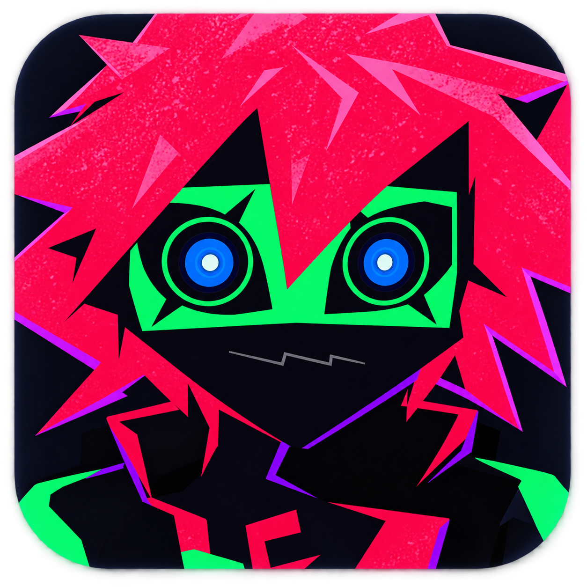
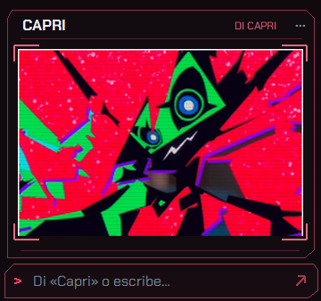
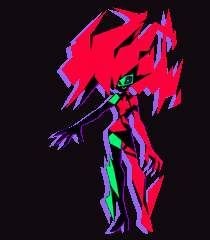

<p align="center"></p>

# Capri · tu compañera de escritorio

[](https://github.com/TheSniperS2/Capri-Capricorn-Para-Escritorio/actions/workflows/tests.yml)

Capri es una compañera de escritorio de código abierto para Windows, inspirada en la estética de *Cyberpunk: Edgerunners*. Puedes conversar con ella usando IA local, hablarle por el micrófono y pedirle acciones sobre aplicaciones compatibles. Vive en una pantalla flotante o como un personaje que se teletransporta, cae y se sujeta en tu escritorio.

**[Descargar una versión](https://github.com/TheSniperS2/Capri-Capricorn-Para-Escritorio/releases) · [Guía de uso](docs/USO.md) · [Documentación](docs/README.md) · [Reportar un problema](https://github.com/TheSniperS2/Capri-Capricorn-Para-Escritorio/issues/new/choose)**

> Las novedades de esta página corresponden a la rama `main`. Una Release anterior puede no incluirlas todavía. Para probar el código más reciente, usa la instalación desde el código que aparece abajo.

## Qué incluye

| Función | Qué ofrece |
| --- | --- |
| Dos formas de acompañarte | Pantalla flotante y personaje, con transformaciones, sombras y efectos eléctricos. |
| Conversación local | Ollama procesa las conversaciones en tu equipo. Elige uno de tus modelos instalados. |
| Voz | Activación al decir «Capri», tecla configurable y sincronización de texto y boca. |
| Cuatro idiomas | Español, inglés, portugués de Brasil y japonés para interfaz, respuestas y voz. |
| Música y sitios | Spotify, pestañas de Opera/Opera GX y controles compatibles de YouTube. |
| Control opcional del equipo | Aplicaciones, ventanas y archivos mediante acciones definidas. Las operaciones sensibles requieren confirmar el objetivo. |
| Apariencia | Tamaño, sombras de color, menú radial y ajustes con temática roja. |

| Pantalla flotante | Personaje en el escritorio |
| :---: | :---: |
|  |  |

## Empieza a usarla

Necesitas **Windows 10 u 11** y **Python 3.12 de 64 bits con Tcl/Tk**. No necesitas una clave de API. La preparación inicial requiere internet y espacio para las dependencias y modelos descargados.

### Componentes mínimos y recomendados

Estas son **orientaciones de dimensionamiento**, no mínimos certificados mediante pruebas en todos esos equipos. El consumo cambia con el modelo, el reconocimiento de voz y los otros programas abiertos.

| Componente | Uso básico, sin conversación con Ollama | Recomendado: voz + IA local pequeña | Mayor margen: juegos + IA local |
| --- | --- | --- | --- |
| Procesador | CPU x64 de 2 núcleos / 4 hilos | 4 núcleos / 8 hilos; AVX2 recomendado | 6 núcleos / 12 hilos o superior |
| Memoria RAM total | 8 GB | 16 GB para Whisper base y modelos de unos 3B cuantizados | 32 GB para convivir con juegos o modelos de 7B–8B |
| Gráficos | Integrados; no requiere GPU dedicada | GPU opcional; CPU funciona con mayor espera | GPU compatible con Ollama, orientativamente 8 GB de VRAM o más |
| Disco libre | Reserva unos 4 GB para entorno y reconocimiento | SSD y unos 12 GB libres, incluyendo Ollama y un modelo pequeño | 20 GB o más si conservas varios modelos |
| Pantalla y audio | 1280×720, salida de audio; micrófono si vas a dictar | 1920×1080 y micrófono con poco ruido | Según tu escritorio y juegos |

Para una experiencia equilibrada, empieza con **16 GB de RAM, SSD, Whisper base y un modelo de aproximadamente 3B**; el instalador propone `llama3.2:3b` cuando aún no elegiste otro. Sin Ollama puedes usar las órdenes directas y el personaje. Una GPU ayuda a la IA compatible, pero no vuelve más rápido automáticamente el reconocimiento: la configuración actual de Whisper usa CPU/int8. Base funciona con menos carga que Small.

La RAM/VRAM disponible importa más que el nombre comercial de la GPU. No toda tarjeta acelera Ollama y no se garantiza una tasa de FPS ni una latencia en estos mínimos orientativos. Para Ollama utiliza Windows 10 **22H2** o posterior y reserva al menos los 4 GB que requiere su instalación, además del espacio de los modelos. Consulta los requisitos oficiales de [Ollama para Windows](https://docs.ollama.com/windows), [GPU compatibles](https://docs.ollama.com/gpu) y el consumo medido por [faster-whisper](https://github.com/SYSTRAN/faster-whisper). Internet se necesita para instalar, descargar modelos y usar la voz natural; la conversación con modelos instalados funciona localmente.

### Apagado, Discord y voz independiente

- **Apagado:** con Control ampliado activado, pide «apaga el computador» y confirma. Capri muestra interferencia roja y un cierre CRT antes de solicitar el apagado a Windows. **Esc cancela durante la animación**. Prueba el efecto sin apagar nada desde **Ajustes → Permisos → Vista previa del apagado**.
- **Discord de escritorio:** «abre Discord», «silénciame en Discord», «desmutéame en Discord», «ensordéceme en Discord», «desensordéceme en Discord» y «únete al canal de voz General en Discord». Para entrar en un canal, abre su servidor; también puedes indicar «del servidor Amigos». Opera sobre controles accesibles, sin contraseña ni token, y no manda atajos a otras ventanas. Si hay ambigüedad o Discord no expone el control, avisa.
- **Voz/acento:** en **Ajustes → Voz → Voz y acento independientes** puedes mantener el idioma español y escoger Thalita brasileña, por ejemplo. El texto sigue en español. La elección se conserva al cambiar de idioma; **Seguir el idioma de Capri** restaura la selección automática. La pronunciación entre idiomas depende de la voz y es preferible usar las variantes multilingües.

### Desde una Release

1. Abre [Releases](https://github.com/TheSniperS2/Capri-Capricorn-Para-Escritorio/releases) y descarga el lanzador **Abrir Capri.pyw**; GitHub puede mostrarlo como `Abrir.Capri.pyw`.
2. Ábrelo con Python. Si no se abre al hacer doble clic, usa `pythonw "Abrir.Capri.pyw"`, ajustando el nombre al archivo descargado.
3. Espera la preparación inicial y entra en **Ajustes → Micrófono** para elegir y probar tu entrada.
4. Prueba **«Capri, abre la calculadora»**. Para conversar, activa la IA local en **Ajustes → IA y servicios**.

El lanzador instala Capri en **`%LOCALAPPDATA%\Capri`**, crea un acceso directo y conserva tus preferencias al actualizar. No requiere administrador ni se añade al inicio de Windows.

### Desde el código más reciente

Descarga el ZIP de la rama `main` desde **Code → Download ZIP**, extráelo y abre PowerShell en la carpeta del proyecto:

```powershell
python empaquetar.py
pythonw ".\dist\Abrir Capri.pyw"
```

El lanzador prepara el entorno. Para ejecutar o modificar los módulos directamente, sigue la [guía de contribución](CONTRIBUTING.md).

## Habla con Capri

Di su nombre y la petición en una frase, o usa **F8**. Puedes cambiar esa tecla presionando la combinación deseada en **Ajustes → Voz**. **Esc** detiene la respuesta. La escucha del nombre se pausa mientras Capri habla y mientras están abiertos los ajustes.

| Puedes pedir… | Capri intenta… |
| --- | --- |
| «Abre YouTube» / «Abre Netflix» | Abrir el sitio en Opera, sin convertir su nombre en una búsqueda de Google. |
| «Busca gatos en Google» | Abrir una búsqueda web. |
| «Reproduce High Forever de mi playlist Capri» | Encontrar la playlist en Tu biblioteca de Spotify y buscar la canción dentro de ella. |
| «Pausa Spotify» / «Siguiente canción» | Controlar su sesión multimedia. |
| «Pon el volumen de YouTube al 50%» | Ajustar el reproductor mediante la integración disponible. |
| «Abre Descargas» | Abrir la carpeta del usuario en Windows. |
| «Cuéntame algo» | Conversar con el modelo local. |

**El resultado depende de la integración.** Capri informa si no pudo confirmar una acción. No lee automáticamente las páginas abiertas ni puede operar cualquier programa de cualquier manera.

### Pantalla, personaje e idiomas

- Haz clic derecho sobre Capri para abrir el menú radial y cambiar de modo.
- Arrastra al personaje y suéltalo para cambiarlo de lugar. Puede explorar ventanas, caer y sujetarse temporalmente.
- Elige **Ajustes → Voz → Idioma de Capri** para cambiar la interfaz y el idioma de sus siguientes respuestas. Los mensajes anteriores conservan su texto.
- El perfil de voz español se conserva al probar otros idiomas. El modelo de conversación y el motor de reconocimiento se configuran por separado.

## Integraciones y requisitos

| Integración | Qué necesita |
| --- | --- |
| Conversación | Ollama y un modelo local instalado. La primera carga y la velocidad dependen del equipo. |
| Micrófono | Entrada seleccionada y modelos locales Whisper/Vosk preparados por el lanzador. |
| Voz natural | Internet: el texto se envía a Microsoft para sintetizarlo. Sin ella se necesita una voz de Windows para el idioma elegido. |
| Spotify | Aplicación de escritorio con sesión iniciada y controles accesibles. Las playlists privadas deben ser accesibles desde esa cuenta. Vincular un enlace es una alternativa, no un requisito general. |
| Opera y YouTube | Opera/Opera GX instalado. Para controles de YouTube en segundo plano puede hacer falta el [puente con Opera](docs/CONECTAR_OPERA.md). |
| League of Legends | Cliente abierto y sala preparada. Busca y acepta desde **Más → League of Legends** o mediante órdenes; consulta la [guía de colas](docs/LEAGUE_OF_LEGENDS.md). La aceptación automática es opcional. |

El **control ampliado** está desactivado inicialmente. Si lo habilitas, Capri usa tus permisos de Windows y solicita confirmación para operaciones sensibles; los archivos borrados se envían a la Papelera. El modelo genera texto y decisiones limitadas al catálogo de acciones, no código ejecutable.

## Tus datos

Las conversaciones se procesan con Ollama local y el historial del chat dura durante la sesión. El audio del micrófono se reconoce en el equipo y se mantiene temporalmente en memoria. La voz natural envía las respuestas a Microsoft; las búsquedas y páginas usan sus servicios respectivos.

Las preferencias, playlists vinculadas, diagnósticos y modelos descargados quedan fuera de Git. La [guía de uso](docs/USO.md) explica las opciones y la solución de problemas.

## Desarrollo y contribuciones

```powershell
python -m venv .venv
.\.venv\Scripts\python.exe -m pip install -r requirements.txt
.\.venv\Scripts\python.exe empaquetar.py
.\.venv\Scripts\python.exe -m unittest discover -s tests -v
```

| Carpeta | Contenido |
| --- | --- |
| [`src/`](src/) | Aplicación, interfaz, animación, voz y ejecutores. Consulta el [mapa de módulos](docs/ARQUITECTURA.md). |
| [`tests/`](tests/) | Regresiones de voz, órdenes, interfaz e instalador. |
| [`integraciones/`](integraciones/) | Puente del navegador y extensión de Opera. |
| [`installer/`](installer/) | Plantilla del lanzador; `empaquetar.py` genera las distribuciones. |
| [`assets/`](assets/) | Ilustraciones, sprites, iconos y tipografía. |
| [`docs/`](docs/README.md) | Guías de uso, integraciones, arte y desarrollo. |
| [`.github/`](.github/) | Automatización, reportes y plantilla para cambios. |

Modifica los módulos originales y vuelve a empaquetar; `dist/` se genera y no se versiona. Las pruebas automatizadas no sustituyen probar el micrófono, las animaciones y las integraciones en Windows.

Las ideas, reportes y contribuciones son bienvenidos. Empieza por [CONTRIBUTING.md](CONTRIBUTING.md), revisa el [registro de cambios](CHANGELOG.md) o abre una propuesta en Issues.

## Licencia y créditos

Proyecto de aficionado, independiente y no oficial. La voz es sintética y no reproduce el timbre exacto de la actriz. El código original usa [MIT](LICENSE); los personajes, marcas, ilustraciones y otros recursos de terceros conservan sus propios derechos. Consulta [THIRD_PARTY_NOTICES.md](THIRD_PARTY_NOTICES.md) y las [referencias](docs/REFERENCIAS.md).

La ilustración experimental de apagado se conserva como recurso de referencia, con su [prompt documentado](docs/PROMPT_APAGADO.md). El efecto actual usa circuitos, interferencia y texto, sin retrato.

La forma de [asomo curioso](docs/PROMPTS_GESTOS_V4.md) conserva el cabello en grandes bloques y los ojos asimétricos de Capri, con núcleos blancos que siguen el cursor y parpadeo. Al cerrar, Capri viaja al centro y dice «Cuídate mucho, choom» con su voz habitual y gestos de sonrisa dentro del visor, antes de la mano y la estrella. Las [llamadas invitadas](docs/VOCES_INVITADAS.md) usan voces sintéticas y diálogos escritos para este proyecto.
