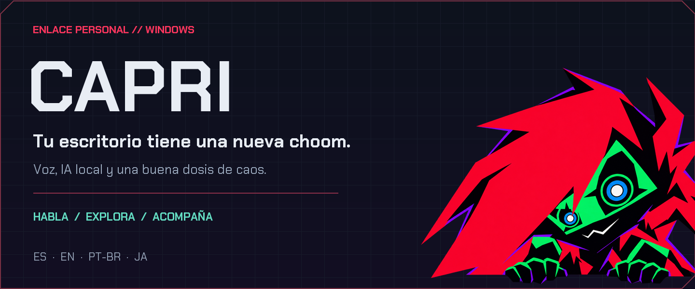
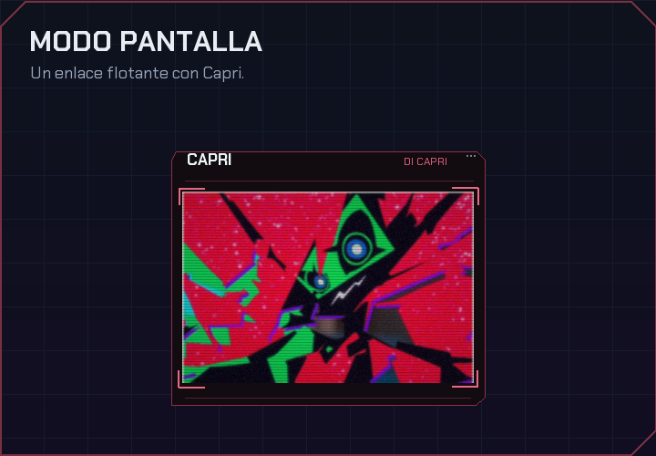
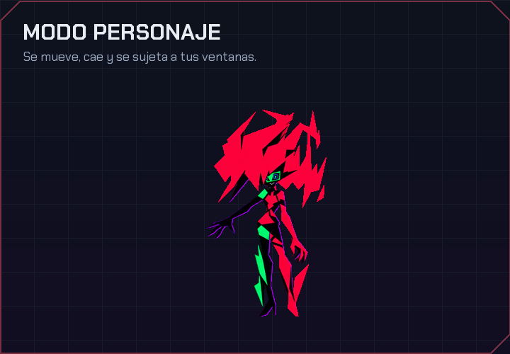
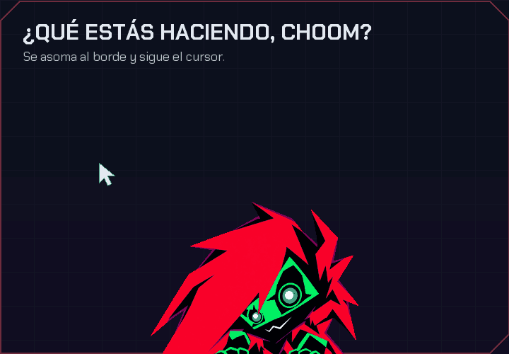
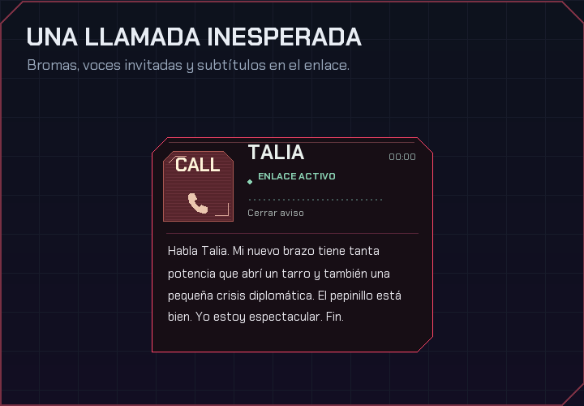
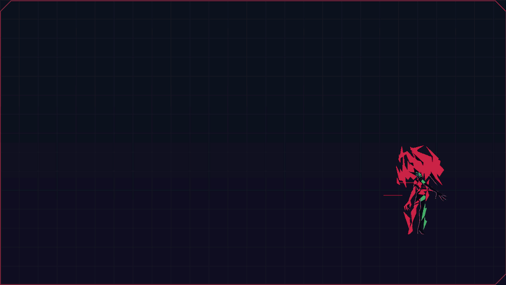
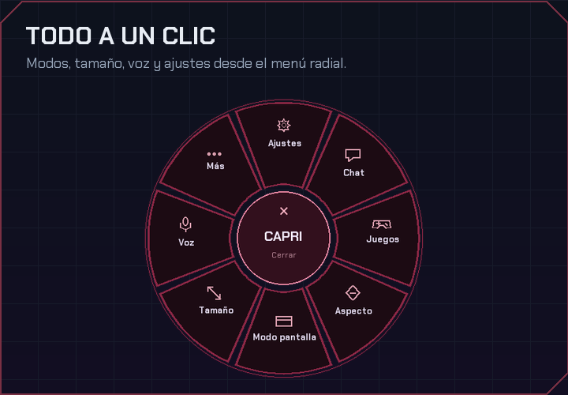
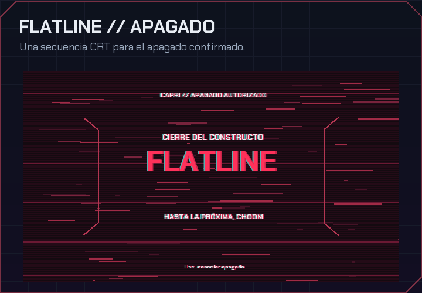

<p align="center">
  
</p>

<p align="center">
  <a href="https://github.com/TheSniperS2/Capri-Capricorn-Para-Escritorio/actions/workflows/tests.yml"></a>
  
  
  
  <a href="LICENSE"></a>
</p>

<p align="center">
  <b>Una compañera que habla contigo, explora tus ventanas y aparece cuando menos lo esperas.</b><br>
  Inspirada en Capri y la estética de <i>Cyberpunk: Edgerunners</i>, hecha para vivir en tu escritorio de Windows.
</p>

<p align="center">
  <a href="#empieza-a-usarla"><b>Empezar</b></a> ·
  <a href="#así-se-ve-capri">Verla en acción</a> ·
  <a href="#componentes-mínimos-y-recomendados">Requisitos</a> ·
  <a href="docs/README.md">Guías</a> ·
  <a href="https://github.com/TheSniperS2/Capri-Capricorn-Para-Escritorio/releases">Releases</a>
</p>

---

## Qué puedes hacer con Capri

Capri combina **personaje de escritorio, voz y conversación con IA local**. Puedes pedirle que abra una aplicación, controle la música o te silencie en Discord. También tiene su propia forma de acompañarte: se asoma por un borde, se sube a las ventanas y te llama para soltar una broma.

La conversación funciona con **Ollama en tu equipo**. La IA es opcional: puedes empezar con el personaje y las órdenes directas, y activar un modelo local cuando quieras. La configuración incluida no necesita una clave de API.

| Función | Lo que puedes hacer |
| :--- | :--- |
| **Dos modos visuales** | Pantalla flotante o personaje, con transformaciones, teletransporte, glitch y sombras de color. |
| **Voz a tu manera** | Habla diciendo «Capri» o usando una tecla. Cambia el perfil, el acento, la velocidad y el volumen. |
| **Cuatro idiomas** | Español, inglés, portugués de Brasil y japonés. El idioma y la voz se eligen por separado. |
| **Conversación local** | Elige entre tus modelos de Ollama y conversa sin enviar el chat a un servicio de IA remoto. |
| **Música y navegador** | Órdenes para Spotify, sitios web y YouTube con la integración de Opera/Opera GX. |
| **Discord y League of Legends** | Controles de voz en Discord y acciones sobre la cola del cliente de LoL. |
| **Un poco de caos** | Asomos que siguen el cursor, llamadas con bromas e invitados, y travesuras opcionales. |
| **Control del equipo** | Aplicaciones, ventanas, archivos y apagado animado mediante permisos y acciones definidas. |

## Así se ve Capri

### Dos formas de acompañarte

Haz clic derecho para cambiar de modo. En pantalla, Capri mantiene su enlace flotante; como personaje, puede moverse por el escritorio, caer y sujetarse a ventanas compatibles, incluidas algunas de sus propias ventanas.

<p align="center">
  
  
</p>

### Tiene sus propias ocurrencias

El **asomo curioso** aparece en los bordes y sigue tu cursor con los ojos. Un clic lo mantiene ahí; arrástrala para desprenderla y recuperar su forma habitual. Las **llamadas** traen bromas de Capri o invitados como King, D, Roman y Talia, con voces sintéticas y subtítulos dentro del enlace.

<p align="center">
  
  
</p>

Puedes activar o desactivar estas interacciones en **Ajustes → Escritorio**, ajustar el intervalo de llamadas y probarlas con **Simular llamada** o **Simular asomo**. Las llamadas se aplazan cuando Capri detecta un juego o una aplicación a pantalla completa en primer plano. Las bromas que minimizan ventanas son opcionales y vienen desactivadas.

### Personalidad hasta el último fotograma

Al cerrar, Capri viaja al centro, cambia de expresión y dice **«Cuídate mucho, choom»** con su voz habitual. Después se transforma en una mano y una descarga que llega hasta la estrella.

<p align="center">
  
  <br><sub>Vista de la secuencia visual, sin audio. La frase se adapta al idioma elegido.</sub>
</p>

### Todo a mano. Y un apagado con estilo.

El menú radial reúne voz, tamaño, modos y ajustes. Si habilitas el control ampliado y confirmas una orden de apagado, Capri muestra una secuencia de interferencia y cierre CRT antes de solicitar el apagado a Windows. Puedes probarla sin apagar el equipo desde **Ajustes → Permisos → Vista previa del apagado**.

<p align="center">
  
  
</p>

<p align="center"><sub>Galería generada con los renderizadores de la aplicación sobre fondos de presentación. <a href="docs/media/readme/README.md">Origen y reproducción de los medios</a>.</sub></p>

## Empieza a usarla

Necesitas **Windows 10/11 y Python 3.12 de 64 bits con Tcl/Tk**. La primera preparación requiere internet para descargar las dependencias y los modelos de reconocimiento.

### La versión actual del repositorio

1. Instala [Python 3.12 para Windows](https://www.python.org/downloads/windows/), con Tcl/Tk y acceso a `python` desde la terminal.
2. [Descarga el código de `main`](https://github.com/TheSniperS2/Capri-Capricorn-Para-Escritorio/archive/refs/heads/main.zip), extrae el ZIP y abre PowerShell en la carpeta del proyecto.
3. Genera y abre el lanzador:

```powershell
python empaquetar.py
pythonw ".\dist\Abrir Capri.pyw"
```

4. Espera la preparación inicial. En **Ajustes → Micrófono**, selecciona y prueba tu entrada.
5. Di **«Capri, abre la calculadora»** o pulsa **F8** para hablar. Para conversar, activa Ollama desde **Ajustes → IA y servicios**.

El lanzador instala la aplicación en `%LOCALAPPDATA%\Capri`, crea un acceso directo y conserva las preferencias al actualizar. No requiere administrador ni se añade automáticamente al inicio de Windows.

> **Las imágenes y funciones de esta página corresponden a `main`.** Las Releases pueden ir por detrás; el método anterior prepara el código actual.

<details>
<summary><b>Prefiero descargar una Release</b></summary>

Abre [Releases](https://github.com/TheSniperS2/Capri-Capricorn-Para-Escritorio/releases), revisa sus notas y descarga **Abrir Capri.pyw**; GitHub puede mostrarlo como `Abrir.Capri.pyw`. Ábrelo con Python. Si el doble clic no funciona, ejecuta `pythonw "Abrir.Capri.pyw"` desde la carpeta donde lo descargaste. También necesitas Python y conexión para la preparación inicial.

</details>

## Componentes mínimos y recomendados

**Puedes usar Capri sin una tarjeta gráfica dedicada.** La carga adicional depende sobre todo de si activas IA local, del tamaño del modelo y del reconocimiento de voz elegido.

| Componente | Punto de partida · personaje y órdenes | Recomendado · voz + IA local pequeña | Más margen · juegos + IA local |
| :--- | :--- | :--- | :--- |
| **Procesador** | CPU x64, 2 núcleos / 4 hilos | 4 núcleos / 8 hilos; AVX2 recomendado | 6 núcleos / 12 hilos o superior |
| **RAM del equipo** | 8 GB | 16 GB para Whisper base y un modelo de unos 3B cuantizado | 32 GB para juegos o modelos de 7B–8B |
| **Gráficos** | Integrados | GPU opcional; la IA también funciona por CPU, con más espera | GPU compatible con Ollama; unos 8 GB de VRAM o más dan margen según el modelo |
| **Espacio libre** | Reserva unos 4 GB para entorno y reconocimiento | SSD y unos 12 GB, incluyendo Ollama y un modelo pequeño | SSD y 20 GB o más para varios modelos |
| **Pantalla** | 1280 × 720 | 1920 × 1080 | Según tu escritorio |
| **Audio** | Salida de audio; micrófono para hablarle | Micrófono con poco ruido | Igual que el recomendado |

Estas cifras son una **guía orientativa, no mínimos de rendimiento certificados**. No se garantiza una latencia concreta: influyen el modelo, la memoria disponible y los otros programas abiertos. Para empezar con IA, una combinación equilibrada es **16 GB de RAM, SSD, Whisper base y un modelo de unos 3B**. El instalador propone `llama3.2:3b` si todavía no elegiste otro.

Ollama requiere **Windows 10 22H2 o posterior**, al menos 4 GB para su instalación y espacio adicional para los modelos. Comprueba sus [requisitos de Windows](https://docs.ollama.com/windows) y [GPU compatibles](https://docs.ollama.com/gpu). El reconocimiento de Capri usa Whisper por **CPU/int8**; una GPU para Ollama no acelera automáticamente ese reconocimiento. Base es más ligero que Small; consulta también las [mediciones de faster-whisper](https://github.com/SYSTRAN/faster-whisper#benchmark).

## Prueba estas frases

Di «Capri» y la petición en una misma frase, o utiliza la tecla para hablar. **F8** es la tecla inicial y puedes cambiarla en Ajustes. **Esc** detiene la respuesta o cancela una animación compatible.

| Para… | Puedes decir… |
| :--- | :--- |
| Abrir una aplicación | «Capri, abre la calculadora». |
| Ir a un sitio | «Abre YouTube» o «abre Netflix». |
| Controlar música | «Pausa Spotify» o «siguiente canción». |
| Elegir un vídeo | «Reproduce el segundo resultado en YouTube». |
| Silenciarte en Discord | «Mutéame el Discord» o «desmutéame en Discord». |
| Entrar en un canal de voz | «Únete al canal de voz General del servidor Amigos en Discord». |
| Usar la cola de LoL | «Busca partida en LoL» o «acepta partida en LoL». |
| Conversar | «Cuéntame algo» — con IA local activada. |
| Apagar el equipo | «Apaga el computador» — con control ampliado y confirmación. |

Las órdenes dependen de la aplicación y de sus controles disponibles. Capri informa cuando no puede confirmar una acción. No opera cualquier programa de cualquier manera.

## Configúrala a tu manera

**Idioma y voz son independientes.** Puedes mantener el texto en español y elegir una voz brasileña, por ejemplo. La elección de voz se conserva al cambiar el idioma; **Seguir el idioma de Capri** devuelve la selección automática. La pronunciación entre idiomas depende de la voz elegida.

| Integración | Qué necesitas | Guía |
| :--- | :--- | :--- |
| **IA local** | Ollama y un modelo instalado. Puedes elegir otro desde Ajustes. | [Modelos y reconocimiento](docs/COMPARACION_MODELOS.md) |
| **Micrófono** | Entrada seleccionada, permiso de Windows y modelo de reconocimiento. | [Voz y primeros pasos](docs/USO.md) |
| **Spotify** | Aplicación de escritorio y sesión iniciada. | [Uso y reproducción](docs/USO.md#elegir-dónde-reproducir-y-qué-resultado-abrir) |
| **YouTube** | Opera/Opera GX; el puente amplía los controles del reproductor y de resultados. | [Conectar Opera](docs/CONECTAR_OPERA.md) |
| **Discord** | Cliente de escritorio y sesión iniciada. Sus controles deben ser accesibles; para unirte, deja abierto el servidor. | [Discord](docs/USO.md#discord) |
| **League of Legends** | Cliente abierto y una sala preparada. La aceptación automática es opcional. No juega ni elige campeones. | [Colas y aceptación](docs/LEAGUE_OF_LEGENDS.md) |

## Tus datos y tus permisos

| Función | Dónde se procesa |
| :--- | :--- |
| Conversación con un modelo instalado | En tu equipo, mediante Ollama local. |
| Reconocimiento del micrófono | En tu equipo, con los modelos descargados. |
| Voz natural | Microsoft recibe el texto que Capri va a leer. Requiere conexión. |
| Voz de Windows | En tu equipo, si tienes instalada una voz compatible con el idioma/acento. |
| Búsquedas y reproducción online | En los servicios que abras o controles. |

El **control ampliado viene desactivado**. Al habilitarlo, las operaciones sensibles requieren confirmar el objetivo; los borrados compatibles van a la Papelera. El modelo decide entre acciones definidas: sus respuestas no se ejecutan como código de consola. Discord usa la sesión ya abierta y no pide tu contraseña ni un token de cuenta.

Los ajustes, playlists vinculadas, diagnósticos y modelos descargados se guardan localmente y quedan fuera de Git. El historial del chat dura durante la sesión. Más detalles en la [guía de uso](docs/USO.md).

## Preguntas rápidas

<details>
<summary><b>¿Funciona sin Ollama?</b></summary>

Sí. El personaje y las órdenes directas no requieren conversación con un modelo. Ollama añade conversación e interpretación con contexto.

</details>

<details>
<summary><b>¿Funciona sin internet?</b></summary>

Después de descargar las dependencias y modelos, el reconocimiento y la conversación local pueden funcionar sin conexión. La voz natural, las descargas y los servicios web necesitan internet. Puedes usar una voz de Windows instalada para lectura local.

</details>

<details>
<summary><b>¿Las voces son las del anime?</b></summary>

Son voces sintéticas configuradas para la aplicación, no grabaciones ni reproducciones exactas de los intérpretes. La despedida usa la voz habitual que hayas elegido para Capri. [Perfiles invitados](docs/VOCES_INVITADAS.md).

</details>

<details>
<summary><b>¿Puedo apagar las llamadas o las travesuras?</b></summary>

Sí. En Ajustes → Escritorio puedes controlar los asomos, las llamadas y las bromas de ventanas por separado. Las bromas que minimizan ventanas están desactivadas inicialmente. La despedida animada se omite si desactivas las animaciones.

</details>

## Construyamos la siguiente versión

¿Tienes una idea para Capri o encontraste una frase que no entiende? Abre una [propuesta o reporte](https://github.com/TheSniperS2/Capri-Capricorn-Para-Escritorio/issues/new/choose) con los pasos, lo que esperabas y lo que ocurrió. Si te gusta el proyecto, una estrella ayuda a que más chooms lo encuentren.

**[Guía de contribución](CONTRIBUTING.md) · [Mapa del proyecto](docs/ARQUITECTURA.md) · [Cambios](CHANGELOG.md) · [Documentación completa](docs/README.md)**

<details>
<summary><b>Preparar el entorno de desarrollo</b></summary>

En Windows con Python 3.12:

```powershell
python -m venv .venv
.\.venv\Scripts\python.exe -m pip install -r requirements.txt
.\.venv\Scripts\python.exe empaquetar.py
.\.venv\Scripts\python.exe -m unittest discover -s tests -v
```

Modifica los módulos de `src/`; `dist/` es una salida generada y no se versiona. Las pruebas automatizadas no sustituyen las comprobaciones de micrófono e integraciones reales. Los medios del README pueden regenerarse con `python scripts/generar_medios_readme.py` desde ese entorno.

</details>

---

<p align="center"><b>«Cuídate mucho, choom.»</b></p>

Proyecto de aficionado, independiente y **no oficial**. El código original está bajo [licencia MIT](LICENSE). Los personajes, marcas e imágenes de terceros conservan sus propios derechos; consulta [créditos y avisos](THIRD_PARTY_NOTICES.md) y las [referencias visuales](docs/REFERENCIAS.md). Las ilustraciones derivadas y sus prompts se documentan en [arte y animación](docs/ARTE_ANIMADO.md).
